# Experiment 1  Linux 基本命令实验报告

学号：B24040212　　姓名：华毅　　实验日期：2026-10-11


## 一、实验目的（Objective）

通过实验熟悉 Linux 操作系统环境，掌握 Linux 基本命令的使用方法。


## 二、实验要求（Requirement）

1. 掌握 Linux 文件权限管理；

2. 掌握基本的文件与目录操作；

3. 掌握 Linux 用户管理；

4. 掌握文件压缩与归档。


## 三、实验环境

| 项目 | 内容 |
| --- | --- |
| 宿主机 | Windows（VMware Workstation，NAT 网络模式） |
| 客户机 | Ubuntu 26.04 LTS（GNU/Linux 7.0.0-31-generic x86_64） |
| 登录方式 | PuTTY / Windows 终端 SSH 远程登录 |
| 虚拟机 IP | 192.168.140.128 |
| 登录用户 | vip |
| 学号后四位 | 0212（用于目录与文件命名） |
| 新建用户 | NY0212（加入 student 组） |


## 四、实验步骤与结果


### （1）目录操作 Directory Operation

依次执行以下命令：

```bash
$ pwd
$ cd ~
$ mkdir 0212
$ cd 0212
$ mkdir cs
$ ls
$ rmdir cs
$ ls
```

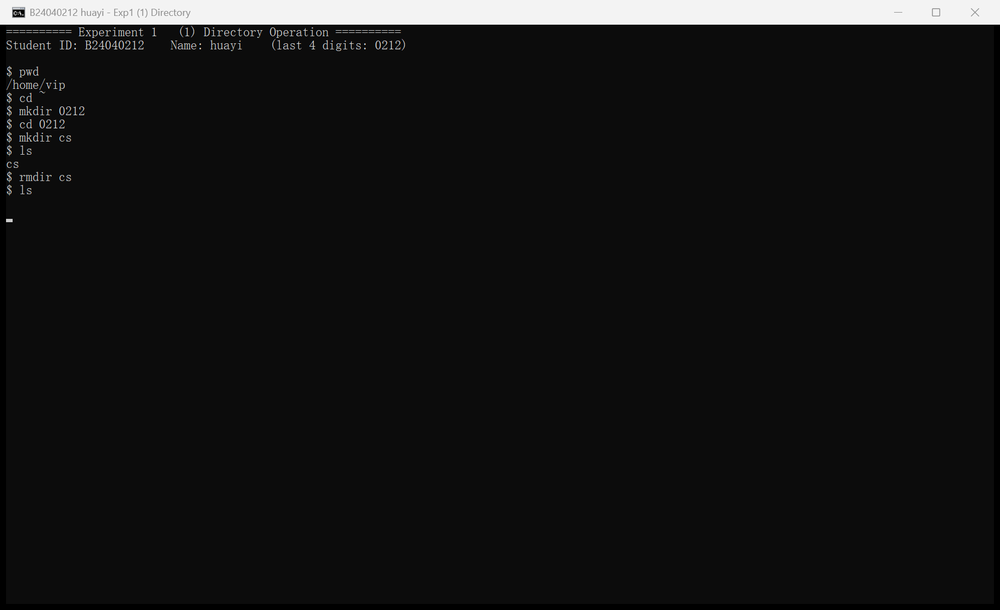

*图 1　（1）目录操作：命令与执行结果*

说明：pwd 显示当前工作目录为 /home/vip；mkdir 0212 在用户主目录下建立以学号后四位命名的目录；进入该目录后创建 cs 子目录，ls 显示创建成功；rmdir cs 删除空目录后再次 ls，目录内容为空，实验成功。


### （2）文件操作 File Operation

依次执行以下命令：

```bash
$ cd ~
$ touch huayi.txt
$ ls
$ echo "hello world" > 0212.txt
$ cat 0212.txt
$ cp huayi.txt 0212_copy.txt
$ mv huayi.txt 0212_newname.txt
$ ls
```

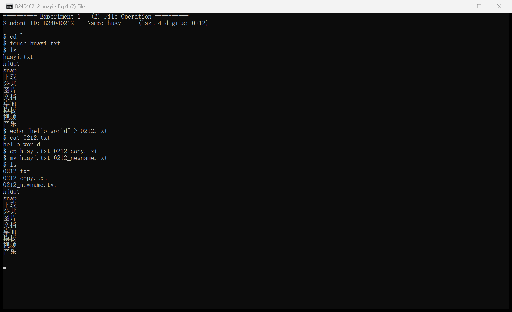

*图 2　（2）文件操作：命令与执行结果*

说明：touch 创建空文件 huayi.txt；echo 配合重定向符 > 将字符串 hello world 写入 0212.txt，cat 读取显示内容正确；cp 完成复制得到 0212_copy.txt；mv 完成重命名，huayi.txt 变为 0212_newname.txt。


### （3）用户管理 User Management

说明：按实验要求，用学号后四位 0212 替换示例中的 0101，即新建用户 NY0212。依次执行以下命令：

```bash
$ whoami
$ sudo su root
（输入当前登录用户的密码）
# groupadd student
# whoami
# adduser NY0212
# usermod -g student NY0212
# su - NY0212
$ cd ~
$ touch NY0212.txt
$ ls -l
```

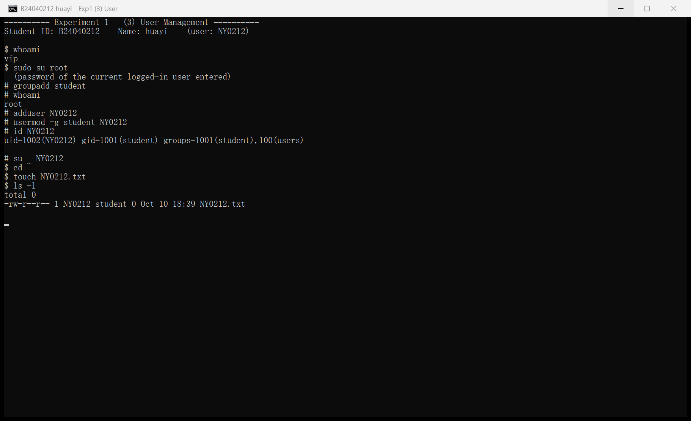

*图 3　（3）用户管理：命令与执行结果*

说明：whoami 显示当前用户为 vip；sudo su root 切换到 root（提示符变为 #），whoami 显示 root；groupadd 新建 student 组；adduser 新建用户 NY0212；usermod -g student NY0212 将该用户加入 student 组，id 命令显示 uid=1002(NY0212) gid=1001(student)；su - NY0212 切换到新用户后创建 NY0212.txt，ls -l 显示该文件的属主为 NY0212、属组为 student。


### （4）权限管理 Permission Management

依次执行以下命令，并在每条命令后运行 ls -l demo 查看权限变化：

```bash
$ touch demo
$ chmod 777 demo
$ chmod a-x demo
$ chmod go-w demo
$ chmod g+w demo
$ chmod a= demo
$ chmod +t demo
$ chmod u+s demo
$ chmod u+rx demo
$ chmod g+rws demo
```

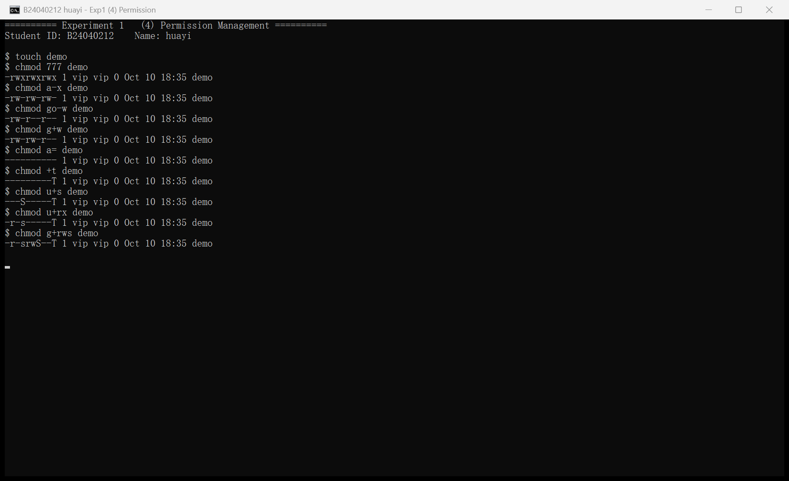

*图 4　（4）权限管理：命令与权限变化结果*

各命令执行后的权限结果如下表所示（与实验指导书完全一致）：

| 序号 | 命令 | 权限结果 |
| --- | --- | --- |
| 1 | chmod 777 demo | rwxrwxrwx |
| 2 | chmod a-x demo | rw-rw-rw- |
| 3 | chmod go-w demo | rw-r--r-- |
| 4 | chmod g+w demo | rw-rw-r-- |
| 5 | chmod a= demo | --------- |
| 6 | chmod +t demo | --------T |
| 7 | chmod u+s demo | --S-----T |
| 8 | chmod u+rx demo | r-s-----T |
| 9 | chmod g+rws demo | r-srwS--T |

说明：chmod 用数字或符号方式修改文件权限。a= 表示清空所有权限；+t 设置粘滞位（因无执行权限显示为大写 T）；u+s 设置 SUID（无执行权限时显示为大写 S）；u+rx 为属主增加读与执行权限，SUID 位显示为小写 s；g+rws 为属组增加读、写权限并设置 SGID。


### （5）其他管理 Other Management

① 压缩与归档：在主目录下创建 others 文件夹并放入两个文件，然后打包与解包：

```bash
$ mkdir others
$ cd others
$ touch file1 file2
$ ls
$ cd ~
$ tar -czvf backup.tar.gz others
$ ls -l
$ tar -xzvf backup.tar.gz
$ ls -l
```

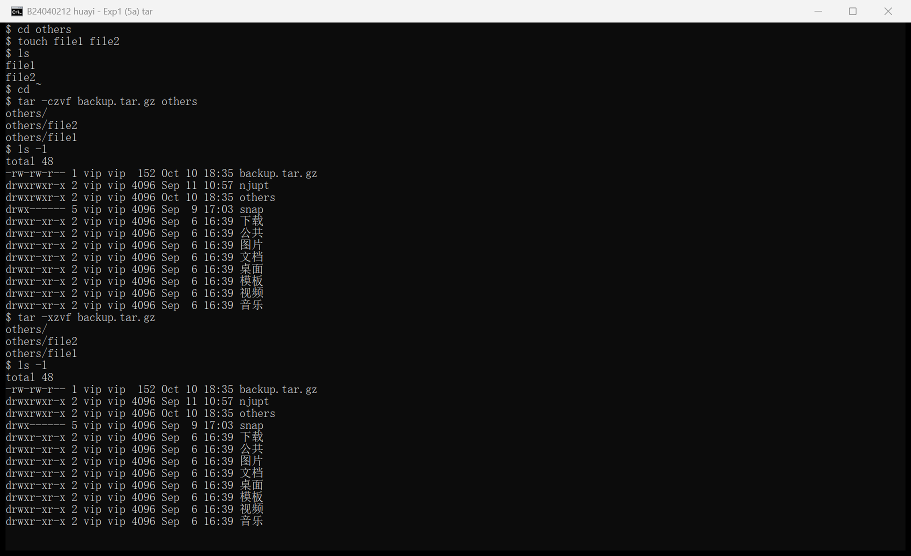

*图 5　（5）其他管理之一：tar 打包与解包*

说明：tar -czvf backup.tar.gz others 将 others 目录压缩打包为 backup.tar.gz，ls -l 可以看到生成的压缩包；tar -xzvf backup.tar.gz 解包后再次 ls -l，可观察到解包过程与文件的变化。

② 文本搜索：创建 textfile 文件并按实验要求写入内容，再用 grep 完成四种查找：

```bash
$ cat > textfile
no, I study in njupt.
this line ends with 00
this line ends with .00
I am 25 years old.
He is 15. It is 16.00
wy is the short of my name.
$ grep '^n' textfile
$ grep '\.00$' textfile
$ grep '5\.\.' textfile
$ grep '^[wy]' textfile
```

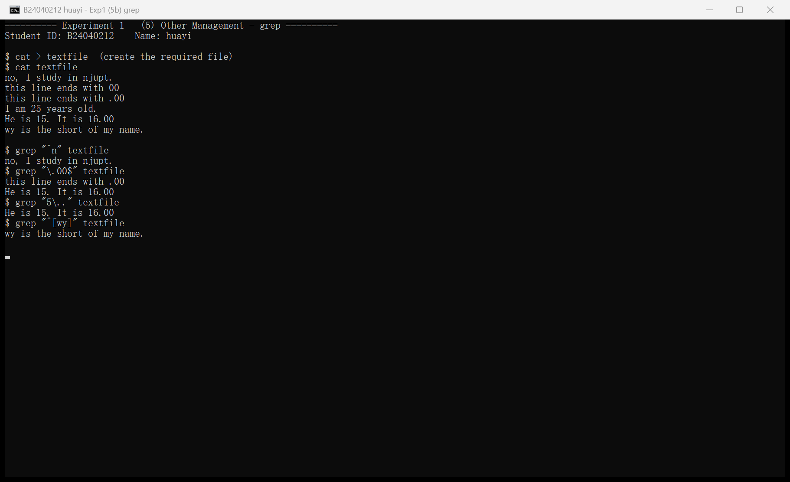

*图 6　（5）其他管理之二：grep 文本搜索*

说明：grep '^n' 查找以 n 开头的行；grep '\.00$' 查找以 .00 结尾的行；grep '5\.\.' 查找包含数字 5 且后面跟一个点和任意字符的行；grep '^[wy]' 查找以 w 或 y 开头的行。四条命令均返回了正确结果。


---


## 五、课堂实践：三个服务器的搭建（完成截图）


### （一）OpenSSH 服务器

在 Ubuntu 虚拟机中安装 openssh-server，并从 Windows 使用远程终端工具登录虚拟机，登录信息显示来源为 192.168.140.1（宿主机），说明远程连接成功建立。

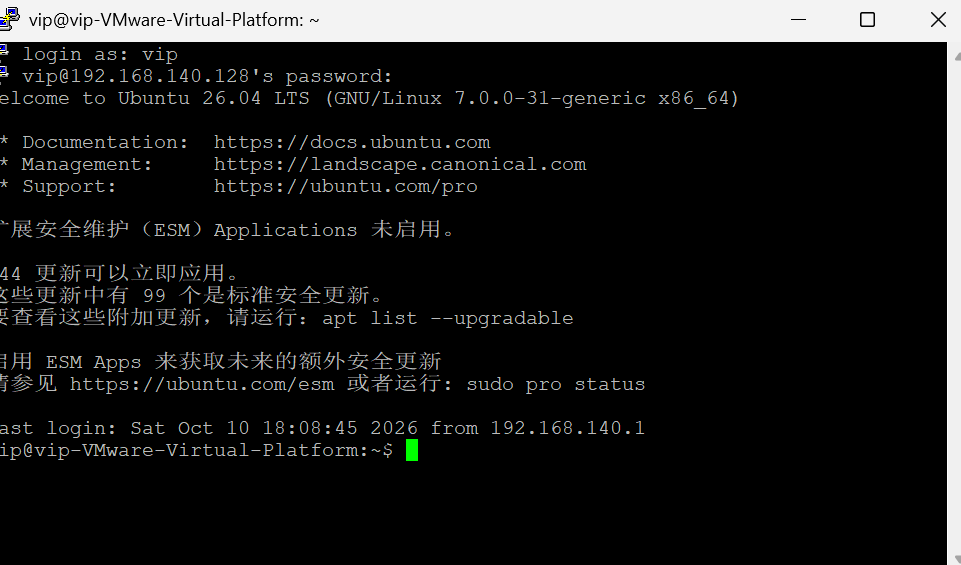

*图 7　OpenSSH：从 Windows 使用 SSH 远程登录 Ubuntu 虚拟机成功*

登录后完成了目录与文件相关的基础 Shell 命令练习（pwd、ls、mkdir、cd、touch、echo、cat），并核对了实验目录与文件内容：

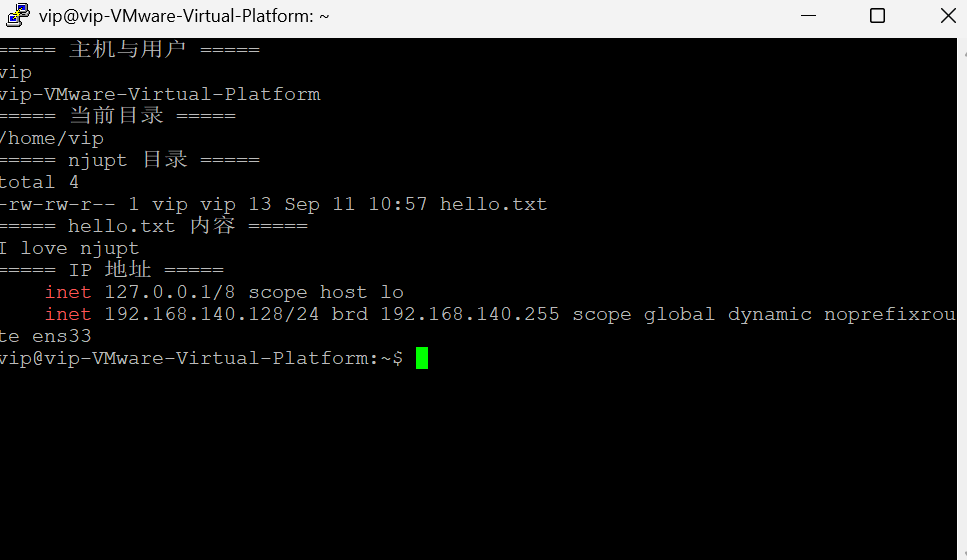

*图 8　OpenSSH：远程终端中的基础 Shell 命令练习结果*


### （二）nginx Web 服务器

在虚拟机中用一条命令 sudo apt install nginx -y 安装 nginx，服务自动启动并设置开机自启；用 ifconfig 查询到虚拟机 IP 为 192.168.140.128，在 Windows 浏览器中访问该地址即可看到 nginx 页面。

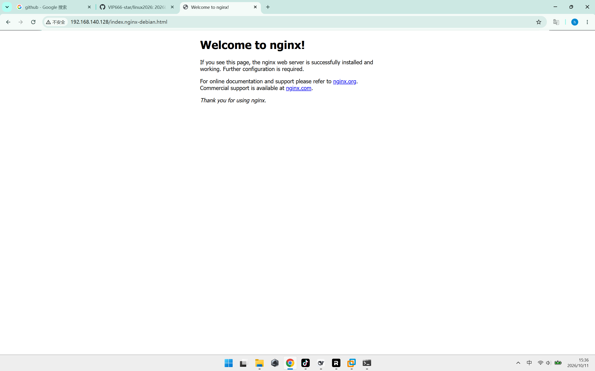

*图 9　nginx：Windows 浏览器访问 http://192.168.140.128/index.nginx-debian.html*

随后切换到 root 用户，在网站根目录 /var/www/html 下创建 index.html，将首页内容替换为自定义页面，并在 Windows 浏览器中刷新验证：

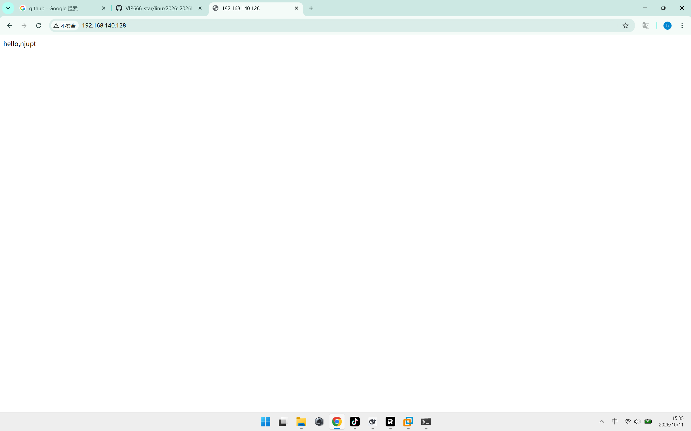

*图 10　nginx：Windows 浏览器访问 http://192.168.140.128 显示自定义页面*


### （三）MySQL 数据库服务器

安装 mysql-server，创建数据库 mydb（字符集 utf8mb4、排序规则 utf8mb4_unicode_ci），创建用户 myuser 并授权，最后用 SHOW DATABASES 验证数据库创建成功；此外还安装了图形化工具 DBeaver，并配置了允许从 Windows 直接访问数据库（bind-address、远程用户与防火墙规则），经实测可从 Windows 远程连接并查询数据。

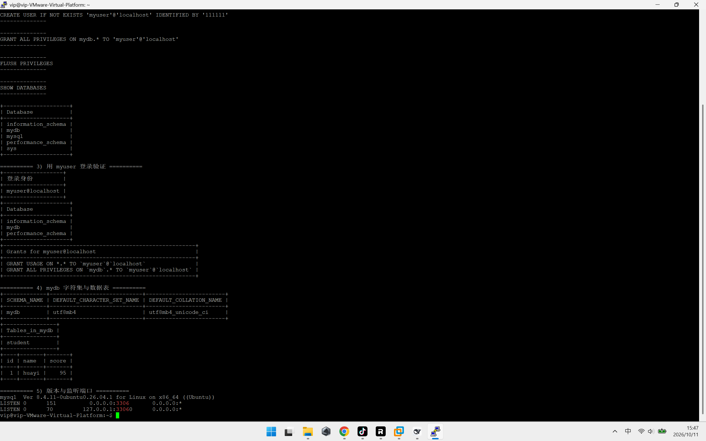

*图 11　MySQL：数据库与用户的创建、授权及验证结果*


## 六、实验小结

本次实验完成了 Linux 基本命令的全部练习：目录操作（pwd、cd、mkdir、rmdir）、文件操作（touch、echo、cat、cp、mv）、用户管理（groupadd、adduser、usermod、su）、权限管理（chmod 的数字与符号两种用法，包括粘滞位、SUID、SGID）以及文件压缩归档（tar）与文本搜索（grep）等操作。

通过实验，掌握了 Linux 中“一切皆文件”的基本操作方式，理解了 Linux 的权限模型（属主/属组/其他，r、w、x 权限位，以及 s、t 特殊权限位）与用户、用户组的管理方式；同时结合课堂实践，完成了 OpenSSH、nginx、MySQL 三个服务器的搭建与验证，对 Linux 作为服务器操作系统的实际使用有了更直观的认识。
