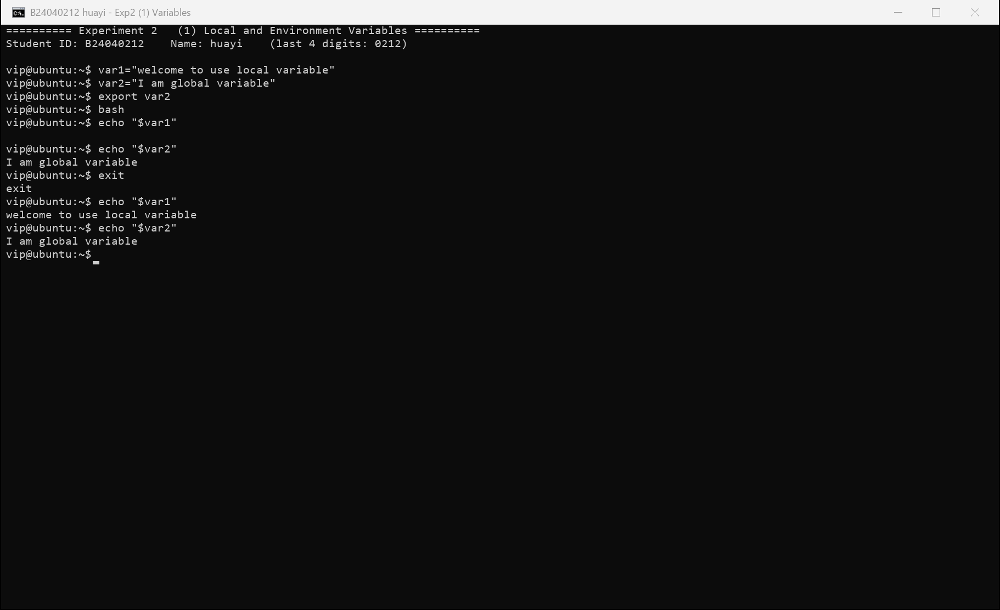
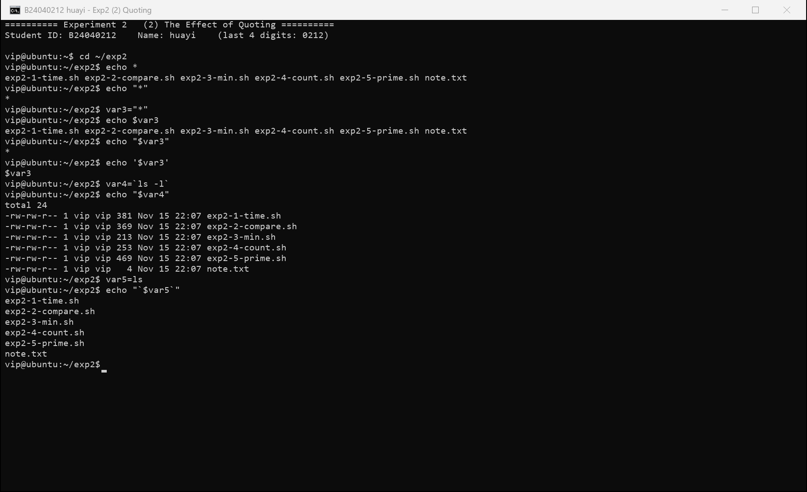
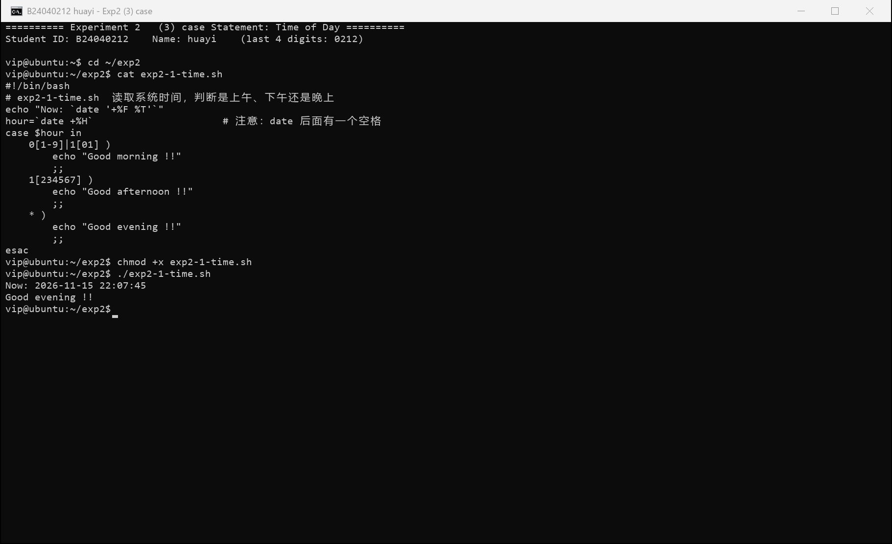
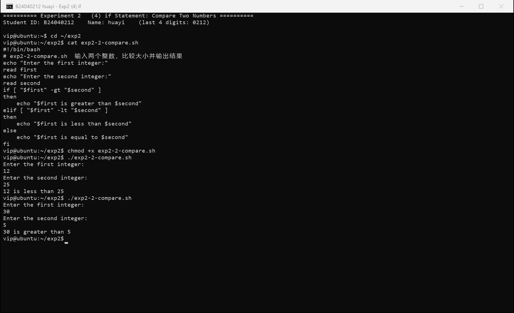
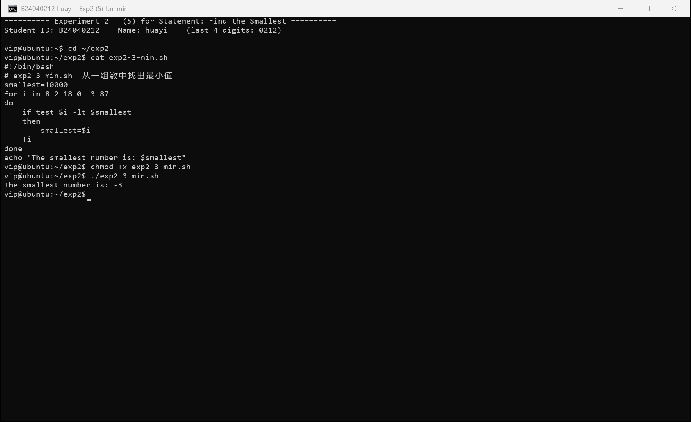
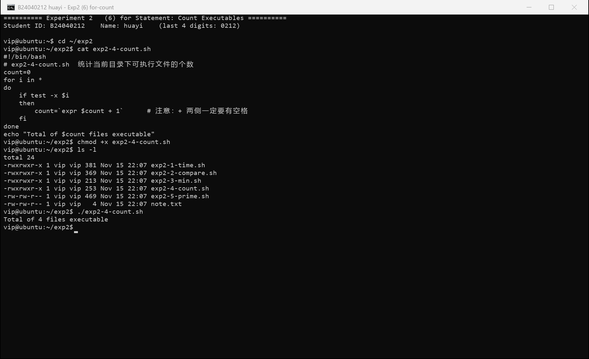
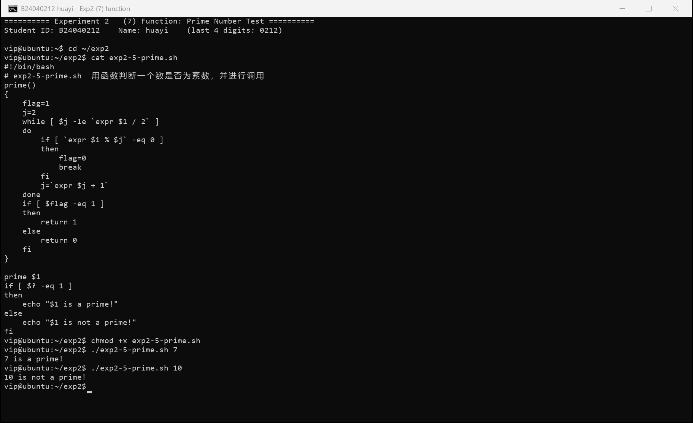

# Experiment 2　Shell 程序设计实验报告

学号：B24040212　　姓名：华毅　　实验日期：2026-11-15


## 一、实验目的（Objective）

进一步巩固 shell 程序设计语言基本语法，加深对所学知识的理解。


## 二、实验要求（Requirement）

1. 局部变量和环境变量；

2. 引号的作用；

3. 控制语句；

4. 函数。


## 三、实验环境

| 项目 | 内容 |
| --- | --- |
| 宿主机 | Windows（VMware Workstation，NAT 网络模式） |
| 客户机 | Ubuntu 26.04 LTS（GNU/Linux 7.0.0-38-generic x86_64） |
| 登录方式 | Windows 终端 SSH 远程登录 |
| 虚拟机 IP | 192.168.140.128 |
| 登录用户 | vip |
| Shell 版本 | GNU bash 5.3.9(1)-release |
| 实验目录 | /home/vip/exp2 |


## 四、实验步骤与结果


### （1）局部变量和环境变量 Local and Environment Variables

在命令行中依次定义局部变量 var1、var2，把 var2 导出为环境变量，然后创建子 bash 验证变量的可见范围：

```bash
vip@ubuntu:~$ var1="welcome to use local variable"
vip@ubuntu:~$ var2="I am global variable"
vip@ubuntu:~$ export var2
vip@ubuntu:~$ bash
vip@ubuntu:~$ echo "$var1"

vip@ubuntu:~$ echo "$var2"
I am global variable
vip@ubuntu:~$ exit
exit
vip@ubuntu:~$ echo "$var1"
welcome to use local variable
vip@ubuntu:~$ echo "$var2"
I am global variable
```



*图 1　（1）局部变量和环境变量：子 shell 中的可见性验证*

说明：var1、var2 都是当前 shell 的局部变量，只在本 shell 中有效；执行 export var2 之后 var2 被加入环境，能被子进程继承。用 bash 创建子 shell 后，echo "$var1" 输出空行（子 shell 看不到未导出的 var1），而 echo "$var2" 正常输出 I am global variable，说明环境变量可以向下传递。exit 退出子 shell 回到原 shell，再显示 var1 和 var2 时两者都正常输出，说明子 shell 中的操作并没有影响父 shell 的变量。


### （2）引号的作用 The Effect of Quoting

在实验目录中依次执行下列命令，观察通配符、双引号、单引号和反引号的不同处理结果：

```bash
vip@ubuntu:~$ cd ~/exp2
vip@ubuntu:~/exp2$ echo *
exp2-1-time.sh exp2-2-compare.sh exp2-3-min.sh exp2-4-count.sh exp2-5-prime.sh note.txt
vip@ubuntu:~/exp2$ echo "*"
*
vip@ubuntu:~/exp2$ var3="*"
vip@ubuntu:~/exp2$ echo $var3
exp2-1-time.sh exp2-2-compare.sh exp2-3-min.sh exp2-4-count.sh exp2-5-prime.sh note.txt
vip@ubuntu:~/exp2$ echo "$var3"
*
vip@ubuntu:~/exp2$ echo '$var3'
$var3
vip@ubuntu:~/exp2$ var4=`ls -l`
vip@ubuntu:~/exp2$ echo "$var4"
total 24
-rw-rw-r-- 1 vip vip 381 Nov 15 22:07 exp2-1-time.sh
-rw-rw-r-- 1 vip vip 369 Nov 15 22:07 exp2-2-compare.sh
-rw-rw-r-- 1 vip vip 213 Nov 15 22:07 exp2-3-min.sh
-rw-rw-r-- 1 vip vip 253 Nov 15 22:07 exp2-4-count.sh
-rw-rw-r-- 1 vip vip 469 Nov 15 22:07 exp2-5-prime.sh
-rw-rw-r-- 1 vip vip   4 Nov 15 22:07 note.txt
vip@ubuntu:~/exp2$ var5=ls
vip@ubuntu:~/exp2$ echo "`$var5`"
exp2-1-time.sh
exp2-2-compare.sh
exp2-3-min.sh
exp2-4-count.sh
exp2-5-prime.sh
note.txt
```



*图 2　（2）引号的作用：通配符、双引号、单引号与反引号的对比*

说明：

- echo *：不加引号时 * 被 shell 当作文件名通配符展开，输出当前目录下的所有文件名；

- echo "*"：双引号去掉了 * 的通配符含义，原样输出一个 *；

- var3="*" 赋值时双引号保证 * 只作为普通字符存入变量；而 echo $var3 在变量替换之后又对结果做了一次文件名展开，所以仍然列出了文件；echo "$var3" 因为有双引号，变量替换后不再做文件名展开，输出 *；

- echo '$var3'：单引号内的内容全部作为普通字符，不做变量替换，输出 $var3；

- var4 由反引号命令替换赋值：反引号把 ls -l 的输出整体赋给 var4，赋值时不做文件名展开，所以 echo "$var4" 原样输出多行内容（包括权限、属主、大小、时间等字段）；若不加双引号，多行内容会被拆成多个参数并做文件名展开；

- var5=ls 之后用反引号执行变量 $var5 的内容：反引号内先做变量替换得到命令 ls，再执行该命令，因此输出当前目录的文件列表。


### （3）控制语句与函数 Control Statements and Functions

本节按实验要求编写 5 个 shell 脚本，分别使用 case、if、for、while 等控制语句，并把素数判断写成函数后调用。


#### ① case 语句：判断当前时间是上午、下午还是晚上

脚本 exp2-1-time.sh（即 cat exp2-1-time.sh 的输出）：

```bash
#!/bin/bash
# exp2-1-time.sh  读取系统时间，判断是上午、下午还是晚上
echo "Now: `date '+%F %T'`"
hour=`date +%H`                      # 注意：date 后面有一个空格
case $hour in
    0[1-9]|1[01] )
        echo "Good morning !!"
        ;;
    1[234567] )
        echo "Good afternoon !!"
        ;;
    * )
        echo "Good evening !!"
        ;;
esac
```

赋予执行权限后运行：

```bash
vip@ubuntu:~/exp2$ chmod +x exp2-1-time.sh
vip@ubuntu:~/exp2$ ./exp2-1-time.sh
Now: 2026-11-15 22:07:45
Good evening !!
```



*图 3　（3）① case 语句：根据系统时间判断上午/下午/晚上*

说明：hour 由反引号命令替换 date +%H 得到当前小时数（两位数，如 22），case 语句依次用模式匹配：0[1-9]|1[01] 匹配 01～11 点为上午，1[234567] 匹配 12～17 点为下午，剩下的情况（18～23 点及 0 点）由 * 分支处理为晚上。本次实验在 22:07 运行，因此输出 Good evening !!，结果与系统时间一致。


#### ② if 语句：输入两个整数比较大小

脚本 exp2-2-compare.sh（即 cat exp2-2-compare.sh 的输出）：

```bash
#!/bin/bash
# exp2-2-compare.sh  输入两个整数，比较大小并输出结果
echo "Enter the first integer:"
read first
echo "Enter the second integer:"
read second
if [ "$first" -gt "$second" ]
then
    echo "$first is greater than $second"
elif [ "$first" -lt "$second" ]
then
    echo "$first is less than $second"
else
    echo "$first is equal to $second"
fi
```

赋予执行权限后运行（分两次输入不同的数据，验证大于和小于两种情况）：

```bash
vip@ubuntu:~/exp2$ chmod +x exp2-2-compare.sh
vip@ubuntu:~/exp2$ ./exp2-2-compare.sh
Enter the first integer:
12
Enter the second integer:
25
12 is less than 25
vip@ubuntu:~/exp2$ ./exp2-2-compare.sh
Enter the first integer:
30
Enter the second integer:
5
30 is greater than 5
```



*图 4　（3）② if 语句：比较两个整数的大小*

说明：read 从标准输入读入两个整数，test 命令的 -gt、-lt 分别做“大于”“小于”的整数比较（注意方括号 [ ] 两侧以及运算符两侧都必须有空格）。第一次输入 12 和 25，输出 12 is less than 25；第二次输入 30 和 5，输出 30 is greater than 5，判断正确。实验指导书中 elif 分支的 echo 语句把变量写成了大写 $FIRST，与前面定义的小写变量不一致，会导致输出为空，这里统一改为小写 $first，修正后输出正常。


#### ③ for 语句：从若干个数中找出最小值

脚本 exp2-3-min.sh（即 cat exp2-3-min.sh 的输出）：

```bash
#!/bin/bash
# exp2-3-min.sh  从一组数中找出最小值
smallest=10000
for i in 8 2 18 0 -3 87
do
    if test $i -lt $smallest
    then
        smallest=$i
    fi
done
echo "The smallest number is: $smallest"
```

赋予执行权限后运行：

```bash
vip@ubuntu:~/exp2$ chmod +x exp2-3-min.sh
vip@ubuntu:~/exp2$ ./exp2-3-min.sh
The smallest number is: -3
```



*图 5　（3）③ for 语句：求一组数中的最小值*

说明：把最小值的初值设为一个足够大的数 10000，for 循环依次取出 8、2、18、0、-3、87，每取出一个数就用 test 判断它是否小于当前的最小值，是则更新 smallest。循环结束后最小值为 -3，输出正确。这个算法的思想就是“打擂台”，也说明 shell 变量不需要事先声明类型。


#### ④ for 语句：统计当前目录下可执行文件的个数

脚本 exp2-4-count.sh（即 cat exp2-4-count.sh 的输出）：

```bash
#!/bin/bash
# exp2-4-count.sh  统计当前目录下可执行文件的个数
count=0
for i in *
do
    if test -x $i
    then
        count=`expr $count + 1`      # 注意：+ 两侧一定要有空格
    fi
done
echo "Total of $count files executable"
```

赋予执行权限后，先 ls -l 查看当前目录各文件的权限，再运行脚本：

```bash
vip@ubuntu:~/exp2$ chmod +x exp2-4-count.sh
vip@ubuntu:~/exp2$ ls -l
total 24
-rwxrwxr-x 1 vip vip 381 Nov 15 22:07 exp2-1-time.sh
-rwxrwxr-x 1 vip vip 369 Nov 15 22:07 exp2-2-compare.sh
-rwxrwxr-x 1 vip vip 213 Nov 15 22:07 exp2-3-min.sh
-rwxrwxr-x 1 vip vip 253 Nov 15 22:07 exp2-4-count.sh
-rw-rw-r-- 1 vip vip 469 Nov 15 22:07 exp2-5-prime.sh
-rw-rw-r-- 1 vip vip   4 Nov 15 22:07 note.txt
vip@ubuntu:~/exp2$ ./exp2-4-count.sh
Total of 4 files executable
```



*图 6　（3）④ for 语句：统计当前目录下可执行文件的个数*

说明：for i in * 借助通配符遍历当前目录下的所有文件（包括子目录），test -x 判断文件是否有可执行权限，有则用 expr 做算术加一。用 ls -l 可以看到当前目录共 6 个文件，其中 4 个脚本已经用 chmod +x 加过可执行权限，另外 exp2-5-prime.sh 还没有加、note.txt 是普通文件，因此统计结果为 4，与 ls -l 显示的权限位一致。


#### ⑤ while 语句与函数：判断一个数是否为素数

脚本 exp2-5-prime.sh（即 cat exp2-5-prime.sh 的输出）：

```bash
#!/bin/bash
# exp2-5-prime.sh  用函数判断一个数是否为素数，并进行调用
prime()
{
    flag=1
    j=2
    while [ $j -le `expr $1 / 2` ]
    do
        if [ `expr $1 % $j` -eq 0 ]
        then
            flag=0
            break
        fi
        j=`expr $j + 1`
    done
    if [ $flag -eq 1 ]
    then
        return 1
    else
        return 0
    fi
}

prime $1
if [ $? -eq 1 ]
then
    echo "$1 is a prime!"
else
    echo "$1 is not a prime!"
fi
```

赋予执行权限后，分别用素数 7 和合数 10 测试：

```bash
vip@ubuntu:~/exp2$ chmod +x exp2-5-prime.sh
vip@ubuntu:~/exp2$ ./exp2-5-prime.sh 7
7 is a prime!
vip@ubuntu:~/exp2$ ./exp2-5-prime.sh 10
10 is not a prime!
```



*图 7　（3）⑤ while 语句与函数：判断一个数是否为素数*

说明：把素数判断写成函数 prime()，函数内部用 while 循环让 j 从 2 递增到 \$1/2，用 expr \$1 % \$j 求余数，一旦余数为 0 就说明有因子，把 flag 置 0 并用 break 提前结束循环。函数用 return 1 表示是素数、return 0 表示不是素数，脚本主体通过 \$1 接收命令行参数，调用函数后用 \$? 取出返回值再决定输出哪句提示。测试 7 输出 7 is a prime!，测试 10（因子 2、5）输出 10 is not a prime!，结果正确。


### （4）脚本清单

5 个脚本的源文件同时保存在本目录的 `scripts/` 子目录中，内容与上面各小节列出的一致。

| 文件名 | 功能 | 主要语法 |
| --- | --- | --- |
| exp2-1-time.sh | 根据系统时间判断上午/下午/晚上 | 命令替换、case、模式匹配 |
| exp2-2-compare.sh | 输入两个整数并比较大小 | read、if/elif/else、test 整数比较 |
| exp2-3-min.sh | 求一组数中的最小值 | for 循环、if、变量赋值 |
| exp2-4-count.sh | 统计当前目录下可执行文件个数 | for 通配符遍历、test -x、expr 算术运算 |
| exp2-5-prime.sh | 判断一个数是否为素数 | 函数、while 循环、break、return 与 \$? |


## 五、实验小结

本次实验完成了 shell 程序设计的全部练习内容：先通过定义 var1、var2 和 export var2，在子 shell 中验证了局部变量与环境变量的作用范围；再通过 echo *、echo "*"、echo \$var3、echo "\$var3"、echo '\$var3' 以及反引号命令替换，理解了单引号、双引号、反引号和通配符分别在哪一步起作用；最后编写了 5 个脚本，覆盖了 case 多分支、if/elif/else 选择、for 遍历、while 循环和函数定义与调用等控制语句。

通过实验，进一步理解了 shell 中“变量替换—命令替换—文件名展开”的先后顺序，以及引号对每一层处理的影响；也体会到 test、expr、echo \$? 这些命令在条件判断和函数返回值处理中的用法。shell 脚本虽然语法简单，但非常依赖空格、引号和反引号这些细节，实验中遇到的 \$FIRST 大小写不一致等问题也说明编写脚本后必须逐个分支实际运行验证。
